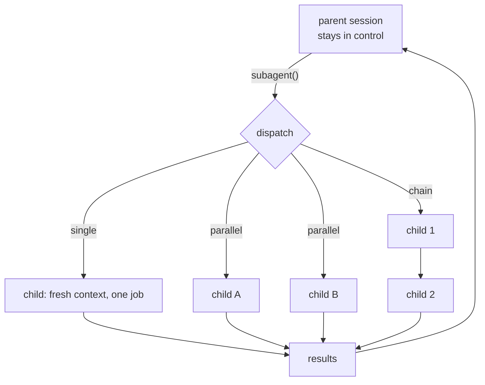

<p align="center">
  
</p>

# pi-cohort

[](https://buymeacoffee.com/jjurasszek)

Coordination for the [pi coding agent](https://github.com/earendil-works/pi): one parent agent delegates to focused child agents.

## The problem

A single agent reviewing its own work is theater - it shares the blind spots that produced the bug in the first place. And one agent can't hold a large task, a plan, and three parallel audits in one context without drift: the further into a task it gets, the more the earlier decisions blur.

`pi-cohort` gives the parent agent a `subagent()` tool to delegate to focused child agents, each with its own fresh context and one job. The parent stays in control and brings results back - a team with one orchestrator, not a swarm.

## Why this is different

- **Fresh eyes, not the same model talking to itself.** A reviewer child has no stake in the code it's checking and no memory of writing it.
- **The parent stays in control.** Children don't spawn their own children unless explicitly allowed (`tools: subagent`), and nesting is depth-capped - no runaway fanout.
- **Delegation is a tool call, not a mode switch.** You keep talking to Pi normally; it decides when a task benefits from a second set of eyes, a parallel scout, or a background run.

## Part of the pi agent toolkit

Four independent extensions for the [pi coding agent](https://github.com/earendil-works/pi), each owning one concern of running agents seriously:

- [pi-quiver](https://github.com/jjuraszek/pi-quiver) - capabilities (fetch, doc conversion, session tools)
- **pi-cohort - coordination (delegate to focused child agents)**
- [pi-condense](https://github.com/jjuraszek/pi-condense) - context economy (prune context, keep it recoverable)
- [pi-gauntlet](https://github.com/jjuraszek/pi-gauntlet) - process (the gated brainstorm->ship workflow)

[pi-gauntlet](https://github.com/jjuraszek/pi-gauntlet) has a hard runtime dependency on this package - its personas dispatch through `subagent()`. The rest are complementary, not required.

## Installation

Requires Pi >=1.3.0.

```bash
pi install npm:pi-cohort
```

That is the only required step.

Children and detached coordinators use the originating parent's resolved Node executable and Pi entry path directly, bypassing `PATH`. Revival keeps that original runtime even when requested from a different parent installation. When the parent is not launched through Pi's CLI (an SDK-hosted session such as Pi Web, where `process.argv[1]` is the host's entry), children use the Pi installation this extension was loaded from: the package directory Pi reports for itself, accepted only when it is `@earendil-works/pi-coding-agent` and its declared `bin.pi` resolves inside that package. Single-file Pi binaries and hosts whose `process.execPath` is not a Node binary remain unsupported. These paths are not a version lock: replacing Node or Pi in place changes what runs. If the original installation is removed, restore it at the recorded paths or start a new run; there is no fallback to the current parent's installation. Legacy records without an original runtime identity remain inspectable but cannot be revived - start a new run.

## Execution backend extension API

External execution backends are currently unsupported on Windows, for both foreground and background runs. Native execution remains supported.

`pi-cohort/execution-backend` requires Pi >=1.3.0 and is the public API for Pi extensions that add child execution surfaces. Pi's TypeScript-aware runtime loads the API; bare Node is not a supported execution path. Consumers outside Pi must supply a TypeScript-aware loader such as [jiti](https://github.com/unjs/jiti).

An adapter registers its backend in extension load order. To make that backend available to background runs, registration also supplies an optional reload descriptor:

```ts
import {
  EXECUTION_BACKEND_PROTOCOL_VERSION,
  registerExecutionBackend,
  type ExecutionBackendFactory,
} from "pi-cohort/execution-backend";
import { createBackend } from "./adapter.ts";

export const createExampleBackend: ExecutionBackendFactory = createBackend;

// src/execution-backend.ts, exported as "./execution-backend".
// Pi invokes the default extension; the coordinator invokes only the factory.
export default async function () {
  registerExecutionBackend(await createExampleBackend(), {
    reload: {
      protocolVersion: EXECUTION_BACKEND_PROTOCOL_VERSION,
      packageJsonUrl: new URL("../package.json", import.meta.url).href,
      publicSubpath: "./execution-backend",
      factoryExport: "createExampleBackend",
    },
  });
}
```

The descriptor has exactly four fields. `packageJsonUrl` must be an absolute `file:` URL for the adapter package's real `package.json`. `publicSubpath` must be `"."` or an explicit non-pattern `"./..."` entry in that package's `exports`. `factoryExport` names a public, zero-argument export from that subpath; it may return the backend or a promise of it. The reconstructed backend must have the same `name` and protocol version as the original registration.

Cohort serializes only backend names and validated reload descriptors into its detached coordinator - never live backend objects or an environment capsule. The coordinator reloads registrations in their original order before selecting a backend, and every child launch receives its exact resolved `cwd`. Selecting `native` bypasses reload entirely. An explicit backend selection reports that backend's reload failure; `auto` reports any registered reload failure rather than silently changing policy. Once reload succeeds, normal auto-detection still falls back to native when no registered backend is available. Backends registered without `reload` remain usable in the foreground but cannot be reconstructed for a background run.

A backend whose surface sets its own identity variables declares them with `surfaceEnvironmentPrefixes` (for example `["CMUX_"]`). Each child attempt then drops the parent's keys with those prefixes and takes the launched surface's values instead, so mux-aware tools in the child address the child's surface. Prefixes must be nonblank strings.

## Mental model

Pi is the parent session. A subagent is a focused child Pi session with its own job. When you ask for a subagent, Pi starts the child, gives it the task, and brings the result back. Foreground runs stream in the conversation; background runs keep working and can be checked later.

Installing the extension does not start an automatic reviewer in the background - it gives Pi a delegation tool. If you want every implementation reviewed, say so in your prompt or project instructions:

```text
When you finish implementing, run a reviewer subagent before summarizing.
```



## Quick example

You do not need to create agents, write config, or learn slash commands. After installing, ask Pi for delegation in plain language:

```text
Use reviewer to review this diff.
```

```text
Ask oracle for a second opinion on my current plan.
```

```text
Run parallel reviewers: one for correctness, one for tests, and one for unnecessary complexity.
```

Run implementers and spec reviewers in the first call, stopping the chain on `FAIL`:

```ts
subagent({ async: false, chain: [
  { parallel: [
      { agent: "implementer", as: "impl_1", task: "Implement task 1", outputSchema: statusSchema },
      { agent: "implementer", as: "impl_2", task: "Implement task 2", outputSchema: statusSchema },
    ], worktree: true, stopOn: { path: "/status", in: ["NEEDS_CONTEXT", "BLOCKED"] } },
  { parallel: [
      { agent: "spec-reviewer", as: "sr_1", cwd: "{outputs.impl_1.treePath}", acceptance: { level: "attested" }, task: "Review {outputs.impl_1.patchPath}", outputSchema: verdictSchema },
      { agent: "spec-reviewer", as: "sr_2", cwd: "{outputs.impl_2.treePath}", acceptance: { level: "attested" }, task: "Review {outputs.impl_2.patchPath}", outputSchema: verdictSchema },
    ], stopOn: { path: "/verdict", in: ["FAIL"] } },
]})
```

The parent applies the accepted patches, runs its tests, and issues a second call for code review over the integrated diff:

```ts
subagent({ async: false, agent: "code-reviewer", task: "Review the integrated diff" })
```

A match ends the chain after that step as a controlled stop (not an error): the result carries a `## Stop` JSON record naming every matching task and a `## Outputs` section with every finished task's output. A chain without `stopOn` behaves exactly as before.

In a saved `.chain.md` the condition is one line per step, the object as JSON:

```md
stopOn: {"path":"/verdict","in":["FAIL"]}
```

That's the whole surface for day-to-day use. More phrasing patterns: [doc/commands.md](doc/commands.md#prompt-cookbook-appendix).

Review and delivery workflows live in pi-gauntlet; pi-cohort ships delegation primitives plus `/investigate` and `/skill:handoff [--out <path> | --key <stem>]` (the brief lands in `<tmpdir>/pi-handoff/<primary>--<leaf>.md` by default; contract in [doc/handoff-template.md](doc/handoff-template.md)).

## Architecture

`subagent()` supports four dispatch shapes, all through the same tool:

| Mode | Use it for |
|---|---|
| Single | One focused child: review a diff, scout a codebase, plan a change. |
| Parallel | N children at once, e.g. three reviewers with different angles. |
| Chain | Sequential steps where each agent's output feeds the next (`scout -> planner -> worker -> reviewer`). |
| Async | Any of the above, backgrounded, so the parent keeps working or ends its turn cleanly. |

`context: "fork"` starts a child from a real branched session instead of a fresh one, when it needs the parent's history. Cost across the whole subtree - main loop plus every foreground/background/nested child - rolls up into one `Σ$` total in the footer; see [doc/observability.md](doc/observability.md).

Each child session is named `<agent> <run id prefix>[/<index>] from <parent>`, so `/resume`, terminal titles, and live-session rosters can tell children apart:

| Child | Session name |
|---|---|
| Single `scout` from a session named `billing reports` | `scout 3f9a2c1e from billing reports` |
| Third task (index 2) of the same parallel run | `scout 3f9a2c1e/2 from billing reports` |
| `scout` from an unnamed session | `scout 3f9a2c1e from <parent session id>` |

The run id prefix works as the `id` for `subagent` status, interrupt, and resume; the index is the child `index` for resume. A nested child names its parent child: `worker 7b41d0aa from scout 3f9a2c1e from billing reports`.

Every child process also gets these environment variables, stable inputs for other extensions (for example, a session roster linking each child to its parent):

| Variable | Value | Set |
|---|---|---|
| `PI_SUBAGENT_CHILD` | `1` | on every child |
| `PI_SUBAGENT_CHILD_AGENT` | the child's agent name | when the agent is known |
| `PI_SUBAGENT_RUN_ID` | the full run id; its prefix appears in the session name | when the run id is known |
| `PI_SUBAGENT_PARENT_SESSION_ID` | the pi session id of the session that launched the child | on every child; a nested child gets its immediate parent's id, never an inherited ancestor's |

Full reference: agent/chain authoring in [doc/agents-and-chains.md](doc/agents-and-chains.md), exact command syntax in [doc/commands.md](doc/commands.md), the raw tool API in [doc/programmatic-api.md](doc/programmatic-api.md).

## Key concepts

| Term | Meaning |
|---|---|
| Subagent | A focused child Pi session with one job and (by default) a fresh context. |
| Agent (persona) | A markdown file with frontmatter defining a specialist: `scout`, `planner`, `worker`, `reviewer`, `context-builder`, `oracle`, `delegate`, `monitor`. Full table: [doc/agents-and-chains.md](doc/agents-and-chains.md#builtin-agents-in-plain-english). |
| Chain | A saved or inline sequence of agent steps, with fan-out/fan-in support and an optional per-step `stopOn` condition that ends the chain when a child's structured output matches (for example a reviewer's `FAIL` verdict). Field reference: [doc/agents-and-chains.md](doc/agents-and-chains.md#stop-conditions-stopon). |
| Fresh vs. forked context | Fresh = clean slate; forked = a real branch of the parent's session history. |
| Recursion guard | Depth cap on nested delegation so a child can only fan out if explicitly allowed. |
| `Σ$` / `cost:external` | The session-wide cost rollup, and the protocol other extensions use to report into it. |

## When to use / when NOT to use

**Use it for:** code review with a second set of eyes, parallel audits (correctness/tests/complexity as separate passes), scoping/planning before a bigger change, background work that shouldn't block the main conversation.

**Don't use it for:** a trivial single-shot edit - the delegation overhead isn't worth it. It's also not an always-on background reviewer; nothing runs automatically unless you or your project instructions ask for it.

## Configuration

Most installs need zero configuration. Set options under `subagents` in the profile's `settings.json` or project `.pi/settings.json`; project levels override the profile, nearest wins. See the [settings reference and migration guide](doc/configuration.md) for defaults, whole-object replacement, and moving legacy configuration.

Run history lives under the pinned profile's `pi-cohort/` root and has no automatic age expiry. Status listings can grow without bound as history accumulates. To remove history manually, delete only a terminal top-level run directory after confirming its entire subtree has stopped; never delete queued or running state, individual nested records, or shared route files. This removes that directory's status and resume lookup, not separately stored session files or shared routes. Keep those sessions if you need their context; deleting a run directory is not a complete session purge. Storage details: [doc/observability.md](doc/observability.md#files-logs-and-observability).

A queued start that never publishes running status stays unresolved: pi-cohort does not automatically recover or revive it. Start a new run instead.

Parent extension CLI flags (e.g. pi-lens's `--no-autofix`) are forwarded into spawned children by default, so subagents inherit the same tooling behavior you launched with; toggle with [`forwardParentFlags`](doc/configuration.md#forwardparentflags).

Optional companions:

- [pi-essentials](https://github.com/jjuraszek/pi-essentials) - lets `context-builder` read referenced URLs. [doc/skills-and-companions.md](doc/skills-and-companions.md#optional-pi-essentials-companion)

## Deeper reference

- [doc/agents-and-chains.md](doc/agents-and-chains.md) - builtin agents, frontmatter, overrides, chain files and variables
- [doc/commands.md](doc/commands.md) - exact slash-command syntax, prompt cookbook
- [doc/programmatic-api.md](doc/programmatic-api.md) - the raw `subagent()` tool parameters
- [doc/configuration.md](doc/configuration.md) - all settings keys
- [doc/observability.md](doc/observability.md) - where runs show up, cost tracking, events
- [doc/skills-and-companions.md](doc/skills-and-companions.md) - skills injection, bundled skill, optional companions
- [doc/orchestration-patterns.md](doc/orchestration-patterns.md) - recommended loop, acceptance gates, worktree isolation, recursion guard

## Relationship to the other repos

`pi-gauntlet`'s gated workflow runs its planner/implementer/reviewer personas through this package's `subagent()` - without pi-cohort, gauntlet has no dispatch mechanism. `pi-condense` reports its own summarization spend through the `cost:external` protocol this package aggregates into `Σ$` (see [doc/observability.md](doc/observability.md)). `pi-quiver` has no code coupling here.

## Roadmap

See [CHANGELOG.md](CHANGELOG.md) for shipped work in progress.

## Contributing

See [CONTRIBUTING.md](CONTRIBUTING.md) - issues follow a Context / Problem / Idea / Acceptance Criteria template; PRs run the [pi-gauntlet](https://github.com/jjuraszek/pi-gauntlet) workflow (one-liners exempt from ceremony, never from keeping docs truthful).

## Support

If `pi-cohort` is useful, consider [buying me a coffee](https://buymeacoffee.com/jjurasszek).
